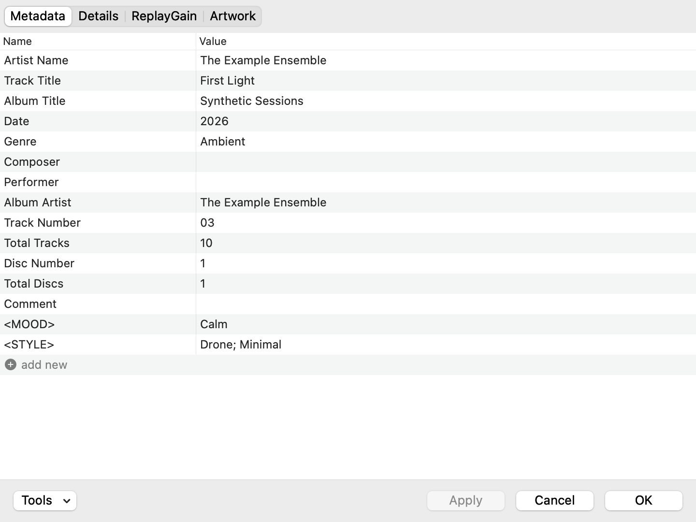

# Windows Properties

**Windows Properties** (`foo_windows_properties.component`) is a component for foobar2000 for Mac (2.26). It
adds a Properties window that works like the foobar2000 for Windows (1.6) Properties dialog, as a Mac window: the
pages **Metadata | Details | ReplayGain | Artwork** on a segmented control, the Windows dialog's Name/Value
list (in the Mac's own type, colours and accent-colour selection), and a button bar in Mac order (the **Tools** pull-down and a status line on the left; **Apply**, **Cancel** and
**OK**, the default button, on the right). You can edit tags straight from the keyboard, a single
click on a value starts editing it, and Return moves on to the next field. With several tracks, double-clicking a field's name
opens **Edit Value**, the host's per-track editor: every track with its own value of that field. **Details** lists what foobar2000 and its components report
about the tracks, **ReplayGain** edits the four ReplayGain values, and the **Artwork** page shows,
adds, replaces, exports and removes embedded pictures (Space shows them in Quick Look, and they drag out as files).

The host's own Properties window is part of foobar2000 and cannot be changed by a component. This
component adds a second command next to it.



*The Metadata page (made-up tags, light appearance, rendered offscreen from the live window by the UI
tests in the classic AppKit design foobar2000 uses; see [Screenshot](#screenshot)).*

At a glance:

- **A Mac window around the Windows lists.** The pages are a native segmented control at the leading edge,
  in line with the list text (⌃Tab, ⌘1…⌘4); the buttons are stock push buttons in Mac order, **Tools**
  (a pull-down) at the left and **Apply · Cancel · OK** at the right, OK the default button on ⌘↩. System font,
  system colours, the accent-colour selection, dark mode and Increase Contrast. Full Keyboard Access reaches
  the page control and the buttons, and VoiceOver reads them, the add row and the Artwork pictures and buttons.
- **Edit from the keyboard.** Click a value or start typing to edit it in place; Return and Tab move on to
  the next field, Esc cancels the edit. ⌘C / ⌘V copy and paste fields as `FIELD=value` lines.
- **Edit Value** for several tracks: double-click a field's name for every track's own value of that field
  (the host's per-track editor, as a sheet), or set one common value.
- **Tools**: Format from Other Fields, Auto Track Number, Copy / Paste / Remove All Fields.
- **Artwork**: add, replace, export and remove embedded pictures; Space shows them in Quick Look, they drag
  out to Finder or other apps as files, and pictures dropped or pasted in are converted only when foobar2000
  could not attach them as they are.
- **Nothing is lost by accident.** Nothing is written before OK or Apply; closing the window or quitting
  foobar2000 with unapplied changes asks first (**Apply**, **Don’t Apply**, **Cancel**), as a Mac document does.

Under the hood:

- Follows the system light/dark appearance.
- Tags and ReplayGain are written through foobar2000's own tag writer (`metadb_io_v2::update_info_async`),
  in one update. Only the fields you changed are touched, so per-track values in «multiple values» rows
  are kept.
- Pictures are written with the SDK's `album_art_editor` under a `file_lock_manager` write lock, one
  edit per physical file, and only for the picture types you changed.
- Nothing is written before **OK** or **Apply**. **Cancel** (or Esc, or ⌘.) discards every staged change,
  tags and pictures alike, at once. Closing the window (the close button, ⌘W) or quitting foobar2000 with changes
  not yet applied asks first, as a Mac document does: **Apply**, **Cancel** or **Don’t Apply**
  ([Closing with unapplied changes](#closing-with-unapplied-changes)).

## Requirements

foobar2000 for Mac 2.26 (tested), macOS 11 or later, Apple silicon or Intel. One download covers both: the
bundle is universal. The component is built against the foobar2000 SDK 2026-10-01 (component API 81).

## Install

1. Download `foo_windows_properties-1.0.0.fb2k-component` from this repository's
   [GitHub Releases](../../releases) page (later also from foobar2000.org).
2. foobar2000 › Preferences… › Components › click + below the list › choose the .fb2k-component (or .zip) › restart when asked.
3. Windows Properties then appears in the component list.

To use it, select one or more tracks, open the context menu (right-click or Control-click) and choose
**Properties (Windows style)…**. It sits directly above foobar2000's own *Properties*. The same command is
in the main menu under **Edit**.

Tip: bind a key to it (see [Binding a keyboard shortcut](#binding-a-keyboard-shortcut)). If you use
FooquX (the companion foobar2000 for Mac UI by the same author), its track menu labels this item
**Properties** (foobar2000's own one becomes *Properties (macOS style)*); while that menu is open, **P**
highlights it and Return opens it.

To uninstall: foobar2000 › Preferences… › Components › select the component › click − below the list › restart.

### If foobar2000 doesn't list or load the component

If foobar2000 doesn't list or load the component after installing, quit foobar2000, remove the download quarantine from the installed bundle and start foobar2000 again:

```sh
xattr -dr com.apple.quarantine <installed bundle>
```

`<installed bundle>` is the installed foo_windows_properties.component folder; for a component installed by hand it is `~/Library/foobar2000-v2/user-components/foo_windows_properties.component`.

## Build from source

Build the bundle as described under [Building](#building), then install it with foobar2000 closed:

```sh
scripts/fetch-sdk.sh          # once: downloads the foobar2000 SDK into third_party/foobar2000-sdk
scripts/build.sh              # -> build/foo_windows_properties.component (universal, ad-hoc signed)
scripts/deploy.sh             # prints the install commands without running them
scripts/deploy.sh --install   # copies the bundle into ~/Library/foobar2000-v2/user-components/
scripts/package.sh            # optional: the installable dist/foo_windows_properties-<version>.fb2k-component
```

`deploy.sh --install` refuses while foobar2000 is running. To install by hand, quit foobar2000 and copy
`build/foo_windows_properties.component` into `~/Library/foobar2000-v2/user-components/`. To uninstall,
quit foobar2000 and delete it from there. The component appears as **Windows Properties** in
foobar2000's component list.

## Opening it

| Where | Item |
| --- | --- |
| Context menu of a track selection (playlist, library, …) | **Properties (Windows style)…**, directly above the built-in *Properties*, with no separator between them |
| Main menu → **Edit** | **Properties (Windows style)…** (acts on the current selection; disabled when nothing is selected) |

The item uses the same parent as the built-in *Properties* (the menu root) and a sort priority just
below it (`src/wpe_menu.h`), so it lands in the same place in every context menu built by
`contextmenu_manager`, both the host's and those drawn by UI components. The host's *Copy name(s)*
item is hidden by default. In a menu that shows hidden items it appears between the two.

Each invocation opens its own window, and further windows cascade. The title is `Properties — <title>`
for one track and `Properties — N Tracks` for several. With one track in a local file the title bar has the
file's proxy icon, as a document window does: Command-click the title for the file's path, drag the icon to
use the file elsewhere (no icon for archive members, streams and the like). The window frame and column widths are remembered
(`NSWindow` frame autosave and `NSTableView` column autosave; the Name column is remembered as its share
of the list width, so it does not drift when the next window has another width). As the window is resized
the Name column keeps that share and Value takes exactly the rest, so the columns always fill the list: no
sideways scrolling, no header stub, long values ellipsized at the window edge.

### The name and the menu text

The component is called **Windows Properties** (bundle `foo_windows_properties.component`, identifier
`io.github.metal2050.foo_windows_properties`). Its menu commands are called **Properties (Windows
style)…**, and that text and their GUIDs are meant to stay fixed: the context item
`{F17421F8-DCDE-4B32-89A4-BC47823D4DDE}` (`src/wpe_menu.h`) and the Edit-menu command
`{CF4EB47A-7E32-4759-8238-8AB8D4825896}` (`src/component.cpp`). Keyboard shortcuts are stored by GUID, and
FooquX (a companion foobar2000 for Mac UI component by the same author) finds the item by that exact
text for its item-menu relabel and P-key defaults. The window's remembered frame, column widths and tab
are kept under fixed keys. Early development builds were called `foo_properties_mac.component`;
`scripts/deploy.sh --install` moves such a bundle aside, because both would register the same commands
and Objective-C classes.

### Binding a keyboard shortcut

foobar2000 › **Preferences…** › **Keyboard Shortcuts** → add a shortcut. Pick one of these actions:

- `[context] Properties (Windows style)…`: acts on the focused selection. This is the closest match
  to Alt+Enter on Windows.
- the main-menu command `Edit / Properties (Windows style)…`

Then press the key you want, for example ⌘I or ⌥↩. Both commands are ordinary bindable actions,
because the context item is mappable and the main-menu item is a normal `mainmenu_commands` entry.

## The window

The title bar is the normal macOS one (see above). Under it, the pages are a native segmented control at the
leading edge of a grey band, its bezel 4 pt in, in line with the list header's **Name** and the list's text; at
the bottom, a grey button bar holds the Tools pull-down and the status line at the left and
Apply, Cancel and OK at the right. These are stock AppKit controls (system font, regular size, no tracking), placed
by their alignment rects, so the margins are the same in both AppKit designs: foobar2000 opts out of the macOS 26
design (`UIDesignRequiresCompatibility` in its Info.plist), and the classic design draws push buttons with shadow
margins outside their bezels.

- Page band: the control 6 pt below the title bar and 6 pt above the list (34 pt in the classic design, 36 pt in
  the macOS 26 one).
- Button bar: 12 pt above and below the buttons (44 pt, or 48 pt in the macOS 26 design), 14 pt from the window's
  sides, 12 pt between buttons. Apply, Cancel and OK share one width, at least 80 pt. OK is the window's default
  button (accent-filled while the window is key); its key is ⌘↩, never plain Return, which belongs to the list.
- Status line: 11 pt in the secondary label colour between Tools and Apply, truncated with the whole text as its
  tool tip, red for errors, and empty when there is nothing to say. A small spinner runs beside it while tags,
  pictures or details are being read or written. There is no Windows status bar or size grip: the window resizes
  from its edges and corners like any Mac window (and its frame is saved when a resize ends).

The lists keep the Windows dialog's layout, measured from screenshots of it (175% scaling, one Windows pixel
at 100% = one point; the screenshots themselves are not published): an 18 pt list header, 21 pt rows, Artwork rows of 106 pt (their three Details
lines 17 pt apart), the Name column's share. Their type and colours are the Mac's:

- Text: the system font at standard sizes (list items 12 pt, the header 11 pt), with no tracking (nothing is
  squeezed to Segoe UI's widths any more), optically centred: the capitals' box on
  the row's centre line, the baseline on the nearest device pixel. That holds for the rows, the header (above its
  bottom line), the Details section bands, ReplayGain, the Artwork names and the block of Artwork Details lines,
  and the Edit Value sheet.
- Colours: the system's semantic colours, so dark mode, Increase Contrast and the accent and highlight colours
  come from macOS. The window, the page band and the button bar are the window background (the title bar's
  colour, so no seam under it), the lists the control background with the system's alternate-row colour, every
  line the separator colour (with a separator above the button bar, as AppKit draws above a window's bottom bar).
- Selection: the accent-colour fill with white text while the list has the focus in the key window, the
  unemphasized grey with the normal text colours otherwise, as in any Mac list.
  «multiple values» text, the add row's ⊕ and the Artwork ⊕/⊗ turn white on the accent fill too.

| Part | |
| --- | --- |
| Pages | **Metadata**, **Details**, **ReplayGain**, **Artwork**. Click one, or press ⌃Tab / ⌃⇧Tab (next/previous, wrapping) or ⌘1…⌘4. With Full Keyboard Access the control takes focus like any other (a segment picked from the keyboard there keeps the focus on the control; a click or a shortcut moves it to the page's list); VoiceOver reads and presses its segments. A new window opens on the page you used last. |
| Button bar | **Tools** (a pull-down, left); **Apply** (enabled only when something changed), **Cancel** and **OK** (the default button, ⌘↩) on the right. |
| Status line | Empty unless there is something to say: `Reading tags…`, `Loading album art…`, `Reading details…` (with a spinner), `Front Cover (pending)`, `Writing 2 fields and 1 picture to 3 files…`, `Updated 3 files.`, or an error. |

### Metadata

The list opens with no row selected, as on Windows (keys then act on the first row). The page has two
columns, **Name** (about 28% of the width; the share is kept when the window is
resized, and dragging the divider changes it) and **Value**. Rows are the list background with every other one
in the system's alternate-row colour, without grid lines (only a faint Name/Value divider). Standard fields always
come first, in the host's
order (Artist Name, Track Title, Album Title, Date, Genre, Composer, Performer, Album Artist, Track
Number, Total Tracks, Disc Number, Total Discs, Comment). They are followed by every other field,
sorted, shown as `<FIELD>`. The last row, **add new** (foobar2000's wording, after a ⊕ glyph that starts where the
names do; VoiceOver reads it as *Add New Field*), starts a new field when you click it, press Return on it, or
start typing on it (the typed text becomes the start of the name).

When the selected tracks disagree on a value, the row shows `«multiple values» a; b; …` in grey. If you
edit it and leave the text unchanged, every track keeps its own value. Any other text sets that value
on all tracks. In a multi-value field the editor lists each distinct value once. To give each track a
value of its own, double-click the row's name ([Edit Value](#edit-value-several-tracks)).

Multiple values in one field are joined with `; `. When you edit a multi-value field, the text is split
on `;` back into separate values. That applies to ARTIST, ALBUM ARTIST, PRODUCER, COMPOSER, PERFORMER,
GENRE and STYLE, and to any field that already has several values. In other fields a `;` is kept as
literal text. Clearing a value removes the field.

The standard-field, multi-value and multi-line lists are read from the host's **Preferences** › **Advanced** page
(*Properties dialog* branch: `properties.standardFields`, `properties.multiValueFields`,
`properties.multiLineFields`, `properties.titleDisplay`). Changes you make there apply to this window too.

### Details

A read-only **Name | Value** list in sections, built the way the host builds its own: every registered
`track_property_provider` service is asked for the selected tracks through the SDK's
`enumerate_properties_helper()`, which uses the newest interface each provider implements (v5 with
metadb v2 records, v4 with abort, v3, v2, v1). The sections and lines are therefore exactly what the
host and other components report: *Location* (File name, Folder name, File path, Subsong index, File
size, Last modified), *General* (Items selected, Duration, Sample rate, Channels, Bits per sample,
Bitrate, Codec, Encoding, Tool, …), *ReplayGain*, *Playback statistics* and anything else a component
adds. Values for several tracks are shown as the providers return them.

- Order: *Location*, *General*, *ReplayGain* first, then the other sections by name; inside a section
  by the provider's sort priority, then by name. Section headers are Mac group rows: 11 pt semibold in the
  secondary label colour on an opaque band in the window's colour, and the header of the section in view stays
  at the top of the list (floating) while its lines scroll under it.
- Technical info fields that no provider claims (`is_our_tech_info`) and none lists are added under
  *General* with foobar2000's label style (`MP3_STEREO_MODE` → *Mp3 stereo mode*).
- Providers older than v4 run on the main thread (the SDK requires it); v4 and later run in a worker
  thread with one shared info source, and closing the window aborts them. The status line says
  `Reading details…` meanwhile.
- The page is read when it is first shown and again whenever the tracks change, including changes
  that only affect display (playback statistics and other metadb hooks); when another tab is showing,
  it is refreshed the next time it is shown. The selection is kept.
- ⌘C (or **Copy** in the context menu) copies the selected lines as `Name: Value` lines; ⌘A selects
  every line. Esc closes the window.

### ReplayGain

**Track Gain, Track Peak, Album Gain, Album Peak**, edited inline exactly like Metadata values (single
click, Return/F2, typing on the list, Return/Tab and Shift+Return/Shift+Tab to move on with wrapping,
↑/↓ without wrapping, Esc to cancel the edit).

- Values are shown as foobar2000 formats them: gains `-6.54 dB` / `+1.20 dB`, peaks `0.987654`. An empty
  value is not set. Tracks that differ show `«multiple values» a; b` in grey; leaving that text as it
  is keeps each track's own value.
- Typed values may have a sign, `.` or `,` as the decimal separator and, for gains, a `dB` suffix
  (`+1.2`, `-6.54 dB`, `-6,54`); they are parsed with the same arithmetic as `pfc::string_to_float`.
  Peaks cannot be negative and gains must be within ±999 dB. Text that does not parse beeps, says why
  in the status line and reopens the editor with the typed text; nothing is staged. The same happens
  whatever ends the edit (Return/Tab, a click on another row, a tab switch, Tools, OK/Apply): the
  command does not run, the page stays, and OK keeps the window open.
- Clearing a value, or Delete/⌫ on the selected rows (**Clear** in the context menu), removes the field.
- Changes are staged like tag edits and written on OK/Apply in the same `metadb_io_v2` update as the
  tags: the `file_info_filter` sets only the changed ReplayGain fields (`get_replaygain` /
  `set_replaygain`) and leaves the other ones, and every tag, as the file has them.

### Keyboard

On the list (not editing):

| Key | Action |
| --- | --- |
| ↑ ↓ Home End Page Up/Down | move the selection |
| Return, Enter, F2 | edit the selected row's value (Return never presses OK; on Details and Artwork it does nothing) |
| any character | start editing the value, replacing it with what you type (dead keys and input methods work) |
| Delete ⌫ / Forward Delete ⌦ | remove the selected fields (a standard row is cleared instead) |
| Insert (Help key on Mac keyboards), or the **add new** row | add a field: type its name, then Return to type its value |
| ⌘C / ⌘V | copy the selected rows as `FIELD=value` lines / paste such lines (or plain text into the one selected row). Continuation lines of multi-line values are indented with a tab; «multiple values» rows are copied with that marker and skipped on paste |
| ⌘A | select all rows |
| ⇧⌘V | **Paste fields** (Tools), on the Metadata list only; in a text editor it is the editor's own Paste and Match Style |
| Esc, ⌘. | **Cancel**: close without writing (never asks) |
| ⌘W | close the window; with changes not yet applied it asks first ([Closing](#closing-with-unapplied-changes)) |
| ⌘Return | **OK**: write and close |
| Tab | move focus to the page control and the buttons (with Full Keyboard Access) |
| ⌃Tab, ⌃⇧Tab, ⌘1…⌘4 | switch tabs (an open edit is committed first) |

While editing a value:

| Key | Action |
| --- | --- |
| Return / Tab | commit and edit the next row's value (wraps from the last row to the first) |
| Shift+Return / Shift+Tab | commit and edit the previous row's value (wraps) |
| ↑ / ↓ | commit and move up/down one row (no wrap). In a multi-line editor they move the caret. |
| Option+Return | insert a line break (a single-line value turns into a multi-line editor) |
| Esc | cancel this edit only (the window stays open) |
| ⌘A ⌘C ⌘X ⌘V ⌘Z ⇧⌘Z | the usual text editing commands |
| ⌘Return | commit, write, close |

While editing a name, which happens for a new field or a rename, Return or Tab moves on to the value
of the same row. A name that already exists jumps to that field instead. An empty name, or Esc, drops
the new row. Names are upper-cased and cannot contain `=`.

An edit never moves the text: the editor is the cell's own text field, filling the whole cell (column line to
column line, the row's full height, in the text background colour, so no selection colour shows around it), with
its text exactly where the cell showed it and the focus ring inside the cell's edges.

Multi-line fields (COMMENT, LYRICS, …, or any value containing a line break) open a text editor floating over the
cell: the Value column's width from the row's top down, no bezel, a hairline frame, a soft shadow and the focus
ring, its first line exactly where the cell's text was. In the list, line breaks are shown as `↵`.

### Mouse

- A single click on a value starts editing it immediately, with the text selected.
- A click on a name, or ⌘/⇧-click, only selects.
- With one track, double-click a name to rename the field. Standard names are labels, so double-clicking one
  edits its value.
- With several tracks, double-click a name (standard or not) to open [Edit Value](#edit-value-several-tracks)
  for that field, as in the host's own Properties. Renaming is then **Rename** in the context menu.
- Clicking anywhere else commits the open edit.
- Right-click opens a menu with **Edit, Add New Field, Remove, Copy, Paste, Capitalize, Auto Track Number**.
  With several tracks it also has **Edit values per track…** and **Rename** (after *Edit*); both act on the
  row you right-clicked.
  - **Capitalize** uppercases the first letter of each word in each track's own value.
  - **Auto Track Number** sets TRACKNUMBER to 1…N in selection order and TOTALTRACKS to N.

### Edit Value (several tracks)

With two or more tracks, double-clicking a row's name, or **Edit values per track…** in its context
menu, opens a sheet titled `Edit Value : <name>`, with the name as the Name column shows it
(`Edit Value : Artist Name`, `Edit Value : <MOOD>`). It lists every track with its own value of that
field. This is the host's per-track editor (`FB2KPropertiesEditMulti.nib`, which the host also shows as a
sheet over its Properties window), in this window's look:

| Part | |
| --- | --- |
| Pages | **Common value** and **Per-track**, the host's two pages, on a segmented control under the heading at the leading edge, in line with the list header's **Item** as in the window. The sheet opens on Per-track; ⌃Tab / ⌃⇧Tab or ⌘1 / ⌘2 switch. |
| Per-track | **Item**: the track, named by the host's `properties.titleDisplay` script (the one the window title uses), else its file name; the tool tip is its path. **Value**: that track's value, several values joined with `; `, empty when the track does not have the field. |
| Common value | One text for every track: the value they share, or `< different values >` when they differ. Leaving the page (or OK) gives every track that text, unless it still reads `< different values >`. Return is OK there, ⌥Return adds a line break. A text area 6 pt in from the page's edges (hairline frame, focus ring), its text 6 pt inside. |
| Bar | `Delimit multiple values with ;` for multi-value fields (the host's wording) at the left (shortened in the middle, full text in its tooltip, when the sheet is too narrow for all of it); **Cancel** (Esc) and **OK** (the default button, ⌘↩) at the right, laid out like the window's bar. |

Values are edited as on the Metadata list: a single click on a value edits it with its text selected;
Return, Enter or F2, or typing on the list, starts editing; Return/Tab commit and move to the next
track's value (wrapping), Shift+Return/Shift+Tab to the previous one; ↑/↓ move without wrapping; ⌥Return
turns the value into a multi-line one (multi-line fields always use the multi-line editor); Esc cancels
the edit only. With no edit open, Esc, ⌘. or **Cancel** close the sheet and drop what was changed in it.
Delete/⌫ clears the selected tracks' values.

**OK** writes nothing: it stages the values in the window, like any other edit. The row then shows the
tracks' values (`«multiple values» a; b; …` while they differ), Apply is enabled, and OK or Apply in the
window writes them in the same `metadb_io_v2` update as everything else, to the tracks whose value
changed and to that field only. A track you did not touch keeps its values exactly and is not rewritten.
When a track is written anyway because of another edit (TITLE on every track, say), the write plan marks
this field *keep* on each track whose staged value is still the one it was loaded with, so the field is
left as the file has it at that moment: a change made elsewhere after the window loaded the tags is
never reverted to the window's copy. The same applies to every per-track staging (Capitalize, Auto
track number, Format from other fields): only the tracks whose value they changed get that field written.
Each track's text is parsed on its own: in a multi-value field (`properties.multiValueFields`, or a
field that already has several values) it is split on `;`; in any other field `;` stays text; an empty
value removes the field from that track only. Opening the sheet again starts from the staged values.

While the sheet is open, tag changes made elsewhere are deferred: after Cancel, or an OK that changed
nothing, they are loaded once the sheet closes. After an OK that stages a change the window has staged
edits, so, as with any staged edit, it does not reload (see [Buttons](#buttons)); the sheet's values and
the list then show the tags as they were when they were loaded, and Apply touches only the tracks and
field you changed. Closing the window discards the sheet; quitting foobar2000 ends it as OK (its values staged) and
then asks about them with the window's other changes.

Differences from the host's sheet: its Item column uses a fixed `%title%` script, this one the
configurable `properties.titleDisplay` (by default `%TITLE%`, so the same names); and the host opens on
Common value when every track already has the same value, while this sheet always opens on Per-track,
which is what the double-click is for. The host's editor has no other fill or auto-number control (Auto
Track Number stays in the context menu and Tools).

### Tools

The **Tools** pull-down (at the left of the button bar) opens a menu of operations on the window's staged
Metadata. An open edit is committed before the menu opens (a ReplayGain value that does not parse keeps it closed).
None of the operations touches a file; they change the list like editing does, and OK/Apply writes the result.

| Item | What it does |
| --- | --- |
| **Format from Other Fields…** | Asks for a field name and a title formatting pattern, and sets that field on every track to the pattern's result for that track. The pattern sees each track's values *as staged in this window* (and its technical info, path, etc.). Results are parsed like typed text (multi-value fields split on `;`; an empty result removes the field). |
| **Auto Track Number** | TRACKNUMBER = 1…N in selection order, TOTALTRACKS = N. |
| **Copy All Fields** | Every field that has a value, as `FIELD=value` lines (the Copy format). |
| **Paste Fields** (⇧⌘V, on the Metadata list) | Sets every field named in `FIELD=value` lines on the clipboard (adding new fields); other fields are kept. Plain text is not pasted. |
| **Remove All Fields** | Removes every field (standard rows are cleared). |
| **Selection ▸** | Edit, Remove, Copy, Paste, Capitalize on the selected rows (the context-menu commands). |

Left out, compared with foobar2000 1.6 for Windows (and the Mac host's own Properties *Tools* menu):

- *Automatically fill values…* (guess fields from file names): a pattern dialog with its own preview
  and source options; not implemented yet.
- *Split values…*, *Clean up*, *Fix spurious discnumbers*: the exact rules foobar2000 applies are not
  documented, so they are not imitated.
- *Reload info*, *Rewrite tags*, *Remove tags*, *Optimize size*, *Show status log*: these act on the
  files directly rather than on the staged list, so they do not belong in a staged editor (they remain
  in foobar2000's own context menu under *Tagging* / *Utilities*).

### Artwork

The page lists the embedded pictures in foobar2000's order: **Front Cover, Back Cover, Artist, Disc,
Icon**, with the columns **Name | Picture | Details | ×**. Details takes whatever width the window and the Name
column leave, so **×** stays at the trailing edge. Rows are 106 pt tall (185 px in the screenshot) and the Picture
cell is square; the thumbnail is fitted 4 pt inside it with 4 pt rounded corners and a hairline edge. The names
and the block of Details lines are optically centred in the row (one line or three).

- A picture that all selected tracks have, byte for byte, is shown with its details on three lines:
  size (`489 KB`, Windows style: whole KB, then MB with three significant digits), dimensions (`600x600`)
  and format (`JPEG`, `PNG`, `GIF`, `WebP`, `BMP`, `TIFF`, `HEIF`, `AVIF`, `ICO`, read from the bytes).
- Tracks that differ (including some with and some without) show `«multiple values»` in grey.
- No picture shows a ⊕ (`plus.circle`) in the Picture cell and `«not present»`. A picture has a ⊗
  (`xmark.circle.fill`) in the last column, always shown. Both are SF Symbols in the tertiary label colour, a step
  darker while pressed, and VoiceOver reads them as *Add picture* and *Remove picture*.

Pictures are read off the main thread with `album_art_extractor` when the Artwork tab is first shown
(each physical file once, under a read lock); closing the window aborts the read.

Editing is staged until OK/Apply (pending rows show their details in italics and the status line says
`… (pending)`). While the pictures are being read (or read back after Apply) the page takes no edits:
⊕ and ⊗ are disabled and a paste or drop beeps, because the result of that read replaces the
rows:

| Action | |
| --- | --- |
| ⊕, double-click a picture, **Import from file…** | choose a picture: JPEG, PNG, GIF, WebP or BMP (kept as they are), or a HEIF/HEIC or AVIF photo or a TIFF (converted as below). Camera RAW, PSD and other image types are greyed out (as full-size PNG they would add tens of MB to every file). |
| Space | Quick Look: the selected pictures, full size (↑/↓ in the panel move through the rows; Space or Esc closes it) |
| ⊗, Delete / ⌫, **Remove** | remove the picture |
| ⌘C / **Copy** | copy the picture's own bytes (plus a TIFF rendition) |
| ⌘V / **Paste here** | paste picture data or an image file, converted as below |
| drag an image file or picture data onto a row | replace that row's picture, converted as below |
| drag a picture onto another row | copy it there, byte for byte (onto its own row nothing happens) |
| drag a picture out (Finder, the Desktop, Preview, Mail…) | a file named as Export names it (`Front Cover.jpg`), the picture's own bytes; apps that take image data get them too |
| **Export to file…** | save the picture's bytes |

A picture brought in from outside (Import, paste, a drop) is attached as foobar2000 attaches pictures: JPEG, PNG,
GIF, WebP and BMP as the file's own bytes, byte for byte. Anything else macOS can decode is converted: a HEIF or
AVIF photo without transparency becomes a JPEG (quality 0.92; it is lossy already, and as a PNG it would be several
times larger in every selected file); TIFF, PDF, ICO and anything with transparency become a lossless PNG. A
converted picture is drawn upright (its orientation tag applied, which players ignore) at full size, in its own
colour space; the pending Details lines show the result (`812 KB`, `3024x4032`, `JPEG`). Pictures already on the
tracks are never converted: OK and Apply write their bytes as they are.

Quick Look shows files in a folder of the window's own under the temporary folder
(`$TMPDIR/io.github.metal2050.foo_windows_properties.QuickLook-…`), written when Space asks for them and removed
when the window closes. VoiceOver reads each thumbnail with its details (*Front Cover, 600×600 PNG, 302 KB*, and
*pending* while staged).

The row context menu uses the host's own wording (from its Properties dialog): *Import from file…*,
*Export to file…*, *Copy*, *Paste here*, *Remove*.

### Buttons

- **OK** writes the changes (tags first, then pictures) and closes the window. The window hides at once
  and closes when writing finishes. If either part fails, it reappears, shows the errors, and keeps
  that part's changes; the part that was written is reloaded from the files.
- **Cancel**, Esc and ⌘. discard the changes at once, without asking (an explicit discard, as on Windows and
  in any Mac dialog). The close button and ⌘W ask first when there is something to lose (below). While OK or
  Apply is writing none of them closes the window (they would stop the pictures after the tags were written);
  the host's progress window can abort the write instead.
- **Apply** writes the changes and keeps the window open. It is enabled only when there are changes.
  The status line shows `Writing N fields and P pictures to M files…` and then `Updated M files.`, or
  the error. A failed write keeps your edits so you can retry. The count is of physical files: a file
  whose tags and picture both failed, or a CUE image with many selected tracks, counts once.
- Aborting the tag update in the host's progress window does not go on to write the pictures; they
  stay staged (`… The pictures were not written.`) for the next Apply.

### Closing with unapplied changes

The window marks itself edited (the dot in the close button) while anything is staged. Closing it then, with
the close button or ⌘W, puts up the Mac's save-changes prompt as a sheet:

> **Do you want to apply the changes you made to 3 files?**
> Your changes will be lost if you don’t apply them.
> **Apply** (the default button, Return) · **Don’t Apply** (⌘D) · **Cancel** (Esc)

The count is of the physical files OK would write. An open edit is committed first, as a click elsewhere commits
it (an editor whose text did not change is no change); a ReplayGain value that does not parse counts as a
change and is back in its editor if you cancel. **Apply** is OK (write, then close; a failure keeps the window
open with the errors and your edits), **Don’t Apply** is Cancel (close, nothing written), **Cancel** goes back
to the window with everything still staged. A window with nothing to lose closes at once, as before.

Quitting foobar2000 asks the same of every Properties window with unapplied changes, in turn, each brought
forward with its own prompt (*foobar2000 is quitting. Your changes will be lost if you don’t apply them.*).
**Cancel** keeps foobar2000 running; **Don’t Apply** closes that window and goes on to the next; **Apply** calls
the quit off at once, writes, closes the window, and then asks foobar2000 to quit again (a failed write keeps it
running, with the errors shown). An open Edit Value sheet ends as OK first (its values staged, then asked about
with the rest); any other sheet (Format from Other Fields, an Open or Save panel, an error report) is cancelled.
A window that is writing (after OK) is not asked about.

How: foobar2000's app delegate has no `applicationShouldTerminate:` (checked in the 2.26 binary's Objective-C
metadata), so a component cannot veto a quit there. The SDK's `app_close_blocker` and
`app_close_blocking_task_manager` can only hold a quit up, not ask about it, and what the Mac host does with them
is undocumented (it has an implementation, but whether it prompts, refuses silently or ignores them cannot be
seen without running it), so they are not used: a quit must never be blocked. The one place a quit can still be
called off is AppKit's own:
`-[NSApplication terminate:]` first has the document controller review edited documents. The component
registers one document, `WPEQuitGuard` (never saved, no window, no file), with the first window it shows; it is
*edited* while any Properties window has something to lose, and its `canCloseDocumentWithDelegate:…` runs the
review above. Every answer reaches AppKit either at once or from the user's click, never from a later
main-queue block, because `terminate:` waits for it in a modal run loop. foobar2000 itself does not use
`NSDocument` (no document actions in its menus), so the document controller this creates changes nothing else.
If a quit still reaches `initquit::on_quit` with a window holding unapplied changes (a quit that bypassed
`terminate:`), that window is closed without writing anything (a write started during shutdown could be cut
off) and the console says so: `Windows Properties: Properties — 3 Tracks was closed with changes that were not
applied (3 files); nothing was written.` Quitting never waits on anything but your answer.

Pictures are written in one `threaded_process` task (the host's progress window appears only for slow
writes, titled *Editing Attached Pictures*): for each physical file (the tracks of a CUE image or other
multi-subsong file share one), a `file_lock_manager` write lock (so a playing file is released and
reopened around the edit), `album_art_editor::g_open`, `set`/`remove` for the changed types only, and
`commit`. The files are then handed to a `metadb_hint_list` and `metadb_io::dispatch_refresh` is called
for the tracks, so playlists and album art views reload them. Failures are reported as
`Attached picture editing failure: …`.

While the window is clean, it reloads when the tracks' tags change elsewhere (pictures too, unless you
have staged picture changes). Tags are read in a worker thread with the window's abort token, so
closing the window stops a slow read; written pictures stop being pending at once and are then read
back from the files. A change that arrives while a cell is being edited or tags are loading is
picked up as soon as that finishes.

## Building

Requirements: Xcode Command Line Tools (Apple clang, macOS SDK), CMake ≥ 3.21 and make, plus the
foobar2000 SDK (a directory containing `foobar2000/` and `pfc/`). The SDK is not part of this
repository: `scripts/fetch-sdk.sh` downloads the version this component is built and tested with
(`https://www.foobar2000.org/downloads/SDK-2026-10-01.7z`, the file linked from <https://www.foobar2000.org/SDK>), checks
its pinned SHA-256 and unpacks it into `third_party/foobar2000-sdk`
(ignored by git), where the scripts and CMake look by default. To use an SDK somewhere else, set
`SDK_ROOT=/path` (scripts) or pass `-DSDK_ROOT=/path` (CMake). macOS's own `tar` unpacks the 7-Zip
archive; if it cannot, the script uses `7zz`/`7z` when installed. `SDK_ARCHIVE=/path/SDK-2026-10-01.7z`
uses an archive you already downloaded (it must have the same hash); `SDK_SHA256=…` changes the expected hash.
An SDK already in the destination is kept when it is 2026-10-01 (`FOOBAR2000_SDK_VERSION` 20261001); one of
another version is replaced only with `--force`, and a folder that is not a foobar2000 SDK never is. The script
writes only to `third_party/foobar2000-sdk` or a folder you name (`scripts/fetch-sdk.sh DEST`), never to `SDK_ROOT`.

```sh
scripts/fetch-sdk.sh # once: the foobar2000 SDK -> third_party/foobar2000-sdk
scripts/build.sh     # arm64 + x86_64 (Unix Makefiles) -> lipo -> ad-hoc codesign
                     # result: build/foo_windows_properties.component
scripts/test.sh      # builds and runs the unit tests (see below); WPE_TEST_ONLY=a,b runs the tests
                     # whose names contain a or b
scripts/deploy.sh    # prints the install commands; nothing is changed
scripts/deploy.sh --install   # quit foobar2000 first (it refuses while foobar2000 runs); copies into
                              # ~/Library/foobar2000-v2/user-components/ and moves a bundle with the
                              # early name foo_properties_mac.component to install-backups/
scripts/package.sh  # build + check (lipo x86_64 arm64, codesign, Info.plist version) and write
                    # dist/foo_windows_properties-<version>.fb2k-component and its SHA-256;
                    # --no-build packages the bundle already in build/
```

The package uses the package format foobar2000 for Mac installs: a ZIP (deflate)
holding exactly `mac/foo_windows_properties.component/…` (`Contents/Info.plist`, `Contents/MacOS/foo_windows_properties`,
`Contents/_CodeSignature/CodeResources`). It is reproducible: sorted entries, fixed timestamps (`SOURCE_DATE_EPOCH`,
else the time of the last commit), normalised permissions, no extended attributes, `__MACOSX/` or `.DS_Store`.
The version is the `project(… VERSION …)` in `CMakeLists.txt`; it sets `DECLARE_COMPONENT_VERSION` and the
bundle's `CFBundleShortVersionString` / `CFBundleVersion`.

The pure C++ model tests (`wpe_tests`) also build without the SDK:
`cmake -S . -B build/model -DWPE_BUILD_COMPONENT=OFF && cmake --build build/model && build/model/wpe_tests`.

The component's own sources build warning-free with `-Wall -Wextra`. The SDK and pfc are built as
separate static libraries with their warnings suppressed.

### Tests

- `wpe_tests` covers the pure C++ models (`src/wpe_model.*`, `src/wpe_art.*`, `src/wpe_rg.*`,
  `src/wpe_details.*`, no SDK and no Cocoa): ReplayGain formatting, parsing, merging, staging and the
  plan; Details grouping, ordering, copy text and unclaimed technical info;
  merging N tracks into rows, standard-field order, `; ` join/split, «multiple values» display,
  editing (set, rename, add, remove, clear), the Tools operations, the write plan and its per-track
  application, idempotence, and which tracks/fields change; the Edit Value model (`PerTrackEdit`: each
  track's text, change detection, merging back as per-track values with untouched tracks kept exactly
and marked *keep* in the plan, so a track written for another field keeps a value changed elsewhere,
renames moving the file's own value on kept tracks,
  per-track multi-value splitting and clearing, the Common value rules); for pictures: merging N tracks
  (present / «multiple values» / «not present»), staging and discarding, the per-file write plan
  (subsongs grouped, matching files and untouched types skipped), format sniffing, header dimensions,
  size text and buffer sharing, committing written pictures, counting failed files, the conversion rule for
  pictures brought in from outside, export/preview file names and VoiceOver's description; the window title
  (`Properties — N Tracks`) and which foobar2000 locations are local files (the proxy icon).
- `wpe_sdk_tests` covers the `file_info` adapter and the `file_info_filter_v2` that applies the plan
  inside foobar2000's tag writer (ReplayGain included, checked against the SDK's own
  `g_format_gain`/`g_format_peak` and `pfc::string_to_float`), and that the Details enumeration uses
  each provider's newest interface (v1…v5), survives a failing provider and stops on abort. It also checks the context item's parent and sort priority against
  the host's root menu children, so the item stays directly above the built-in *Properties*.
- `wpe_ui_tests` drives the real window with synthesized key and mouse events against an in-memory
  backend. The window is never shown, and no defaults or general pasteboard are touched (copy/paste
  tests use private pasteboards). It embeds `tests/host-design-Info.plist`, whose
  `UIDesignRequiresCompatibility` (copied from foobar2000.app's Info.plist) makes AppKit lay out and draw
  in the classic design the window gets inside foobar2000; a test checks that the design really is the
  one the binary asks for. `wpe_ui_tests_macos26` runs the same tests in the macOS 26 design. The chrome is
  measured on the live window: the page band and the button bar at several window sizes (and while resizing
  down to the minimum) on every page, by alignment rects (margins, gaps, equal widths, the bar's insets, the
  control leading-aligned, 4 pt in) and as drawn (the bar and the control rendered with `cacheDisplayInRect:toBitmapImageRep:`:
  each bezel where its alignment rect is, centred in the bar; the page control's bezel in line
  with the list header's first title), and each button's label rendered at 1x and 2x,
  light and dark, enabled and disabled, whose capitals AppKit must centre on the bezel to about a point
  (`WPE_MEASURE=1` prints the measurements); the Edit Value sheet's bar and page control likewise. The lists'
  text is measured the same way: rows, the header, Details section bands, ReplayGain, Artwork names and the
  block of Artwork Details lines, rendered at 1x and 2x, light and dark, selected and emphasized, with the
  capitals' baseline where the centring rule puts it and their box within a few tenths of a point of the centre
  line; the colours as drawn against the system colours they map to (rows, alternate rows, the column line, the
  header, the bars and the bar's separator, the accent and unemphasized selections with white or normal text,
  white glyphs on the accent fill), in light and dark mode; and the inline editors: the editor is the cell's text
  field filling the cell, the text background from the cell's top to its bottom (in a selected and an emphasized
  row), the field editor on the label's text rect, the text drawn to the device pixel where the label drew it
  (Metadata values, ReplayGain, Edit Value, the multi-line overlay), and AppKit's focus ring around the editor's
  mask, drawn into a bitmap, ending at the cell's edges; the multi-line overlay's frame, hairline, shadow and
  focus ring, and Common value's inset text area. It covers
  Return, Tab, Shift, Esc, arrows, typing to edit, Insert, Delete, double-click rename, click-to-edit,
  multi-line editing, OK, Apply, write errors, the context menu, the page control (its shortcuts, a picked
  segment, VoiceOver's press, a ReplayGain value that does not parse keeping its page), the remembered page,
  the button bar in Mac order with OK as the default button on ⌘↩ only (plain Return never reaches it, on any
  page or control), the status line (empty when idle, spinner while reading, red errors), the Tools pull-down
  (title-case items, committing the open edit before it opens, never performing ⇧⌘V itself), asking before
  unapplied changes are lost (⌘W and the close button put up the prompt, once; its text, buttons and keys; Cancel
  keeps everything staged, Don't Apply closes without writing, Apply writes and closes and a failed write keeps the
  window; an open edit committed first, an unchanged one not asked about, an invalid ReplayGain value kept; Cancel,
  Esc and ⌘. still never ask; the quit review asking each window in turn, Cancel calling the quit off, Apply
  calling it off, writing and asking to quit again, a failed write not; an open close prompt answering the quit
  too; Edit Value staged before asking; the quit guard document's edited state and its answer to AppKit;
  `wpe_close_all_windows` at initquit writing nothing and reporting what it dropped), and the real
  `-[NSApplication terminate:]` in a child process (the test binary run again with `WPE_QUIT_PROBE=cancel`,
  `discard` or `apply`: the document review asks, and the app keeps running, quits without writing, or writes and
  then quits), the prompt as AppKit lays it out and draws it offscreen (Apply first and the default button, every
  label centred on its bezel, in both designs), the window title
  and proxy icon, the list metrics measured from the screenshots and the untracked system font, the **add new**
  row (its glyph aligned with the names' text),
  the Tools menu, Format from other fields, the Details page (sections, headers, copy, refresh on
  tag and display changes), the ReplayGain page (inline editing, invalid values, clearing, writing
  with tags, tab switches and Cancel), the floating Details section headers (opaque, at the top of the list),
  and the Artwork page (rows/labels/order, Details filling the width with × pinned trailing at any width, the
  SF Symbol buttons and their pressed state, the inset thumbnail, «multiple values»,
  staging, Cancel discarding, copy/paste/drop, failures, asynchronous loading, no edits while a reload
  runs, Import from file… offering the attachable formats plus HEIF/HEIC, AVIF and TIFF (not RAW, PSD or PDF) and the conversion rule (PNG, BMP and JPEG kept byte for byte, TIFF
  with and without transparency to PNG, a HEIC photo to an upright JPEG, a HEIC with transparency to PNG, text
  refused), Quick Look on Space (the files, their names and bytes, the panel's data source, a newly staged
  picture getting a new file, the window's temporary folder removed on close), VoiceOver's thumbnail
  descriptions, and dragging out (the file promise's name, type and bytes, nothing to drag from «multiple
  values» or «not present», a row dropped on another row copied byte for byte and refused on its own row, a drop
  from elsewhere still converted)), and writing (Cancel/close blocked while writing, an aborted tag update skipping the pictures,
  failures counted per file, invalid ReplayGain text kept across tab switches, clicks and OK, ⇧⌘V only
  on the Metadata list), and the Edit Value sheet (opened by a double-click on a name with several tracks
  and from the context menu, one track still renaming; title, columns and values; single click, typing,
  Return/Tab/Shift/arrows and Esc; Common value; multi-line values and Delete; OK staging and Apply
  writing only the tracks that changed, and not reverting a change made elsewhere on an untouched track
that is written for another edit; Cancel, Esc and ⌘.; reloads deferred while it is open; closing
  the window with it open). It is skipped without a
  window server. With `WPE_SNAPSHOT_DIR=/some/dir` it also renders the pages (light and dark, made-up
  tags and a generated cover) to PNG files there, at 2x and in sRGB, for visual comparison with screenshots
  of the Windows dialog (Details also scrolled, with a floating
  header), Metadata with two rows selected (accent and unemphasized), a value being edited and a multi-line
  overlay, plus the bottom of the live window (list end and button bar) at 916 and 1092 pt, with a pending
  picture in the status line, each button on its own, the Edit Value sheet's two pages, and the close prompt
  (light and dark).

### Screenshot

`docs/screenshot-metadata.png` is `metadata-light.png` from that snapshot run at a 720×540 pt content
size, in the classic design (`wpe_ui_tests`), with every PNG chunk other than `IHDR`, `sRGB`, `pHYs`, `IDAT`
and `IEND` removed (macOS writes an EXIF chunk). No real tags or cover art are involved: the tags are made up
and the cover is a generated single-colour square.

```sh
scripts/test.sh
WPE_SNAPSHOT_DIR=/tmp/wpe-shots WPE_SNAPSHOT_SIZE=720x540 WPE_TEST_ONLY=zz_snapshots build/tests/wpe_ui_tests
```

## Layout

```
CMakeLists.txt              pfc + fb2ksdk static libs, wpe_model, wpe_sdk, the .component bundle, tests
cmake/mac/Info.plist.in     bundle Info.plist (io.github.metal2050.foo_windows_properties)
src/component.cpp           DECLARE_COMPONENT_VERSION, context-menu and Edit-menu commands
src/wpe_menu.h              context item GUID, parent and sort priority (next to the built-in Properties)
src/wpe_model.{h,cpp}       pure C++ table model, edit model, write plan, Tools operations, Edit Value (PerTrackEdit),
                            the window title and which locations are local files
src/wpe_art.{h,cpp}         pure C++ Artwork model: merge, staging, per-file plan, format/size details
src/wpe_rg.{h,cpp}          pure C++ ReplayGain model: format/parse like foobar2000, merge, staging, plan
src/wpe_details.{h,cpp}     pure C++ Details model: provider lines grouped and ordered, copy text
src/wpe_sdk.{h,cpp}         file_info <-> model, host settings, tag/ReplayGain-writing filter, metadb reads,
                            track_property_provider enumeration,
                            album art read/write (album_art_extractor/editor, file_lock_manager)
src/wpe_backend.h           what the window needs (load, write, change notifications, track titles)
src/wpe_backend_fb2k.cpp    foobar2000 implementation of the backend; wpe_open_properties()
src/wpe_window.{h,mm}       the Cocoa window (WPEPropertiesWindowController, WPEWindow, WPETableView, WPEPageTableView, WPEArtTableView),
                            picture conversion, Quick Look and drag-out (WPEArtPromise), the quit review (WPEQuitGuard)
src/wpe_value_sheet.{h,mm}  the Edit Value sheet (WPEEditValueSheet): one field's value per track
src/wpe_views.h             WPEWindow, WPEPageTableView and WPEHeaderCorner, shared by the window and the sheet
src/wpe_chrome.{h,mm}       native chrome helpers (page control, push buttons, default button, Tools pull-down, status
                            line), the system colours (WPEColors), the list header/rows and bars, the list text cell
                            (optical centring, inline editors in place) and the multi-line editors, Artwork glyphs and
                            thumbnails, metrics
src/foobar2000-mac-class-suffix.h   ObjC class suffix (_foo_properties_wpe)
docs/screenshot-metadata.png  the README screenshot (synthetic data, see Screenshot)
tests/                      test_model.cpp, test_art.cpp, test_rg.cpp, test_details.cpp, test_sdk_bridge.cpp, test_ui.mm,
                            host-design-Info.plist (embedded in wpe_ui_tests: the host's AppKit design)
scripts/                    fetch-sdk.sh, build.sh, test.sh, deploy.sh, package.sh, common.sh
dist/                       release packages written by scripts/package.sh (not committed)
third_party/foobar2000-sdk/ the foobar2000 SDK, put there by scripts/fetch-sdk.sh (not committed)
```

All Objective-C classes are prefixed `WPE` and suffixed through `FB2K_OBJC_CLASS`, giving runtime
names such as `WPETableView_foo_properties_wpe`. They cannot collide with other components.

## Credits and licence

- Windows Properties is released under the MIT licence: see [LICENSE](LICENSE). Copyright (c) 2026 metal2050.
- It is built with the [foobar2000 SDK](https://www.foobar2000.org/SDK) by Peter Pawlowski (BSD-style
  licence; `pfc` and `libPPUI` have their own licences). The SDK is not included in this repository;
  `scripts/fetch-sdk.sh` downloads it from foobar2000.org.
- The look and behaviour follow the Properties dialog of foobar2000 for Windows, and the Edit Value sheet
  follows the per-track editor of foobar2000 for Mac. No code from foobar2000 is included.
- This is an independent project. It is not affiliated with, endorsed by or supported by foobar2000 or its
  author.
